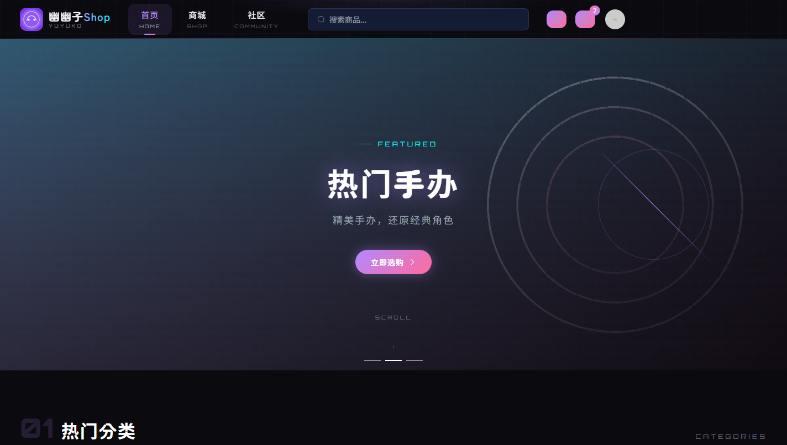
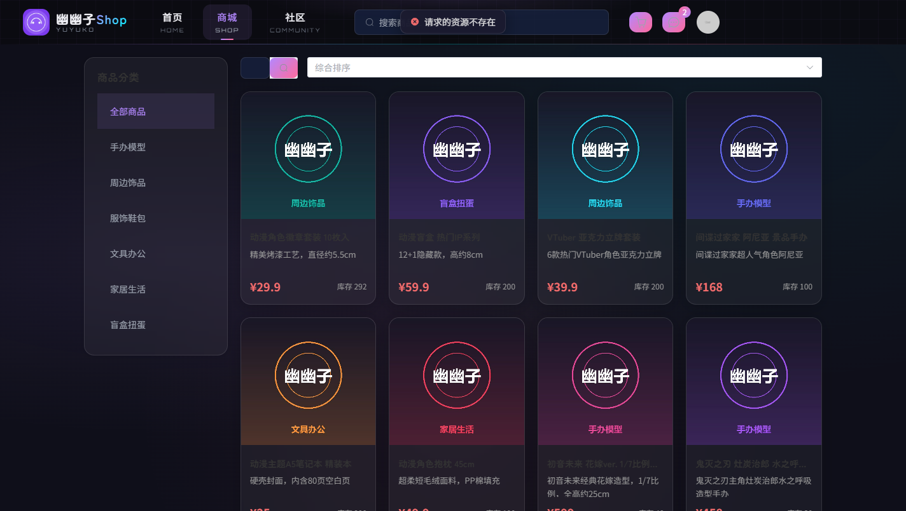
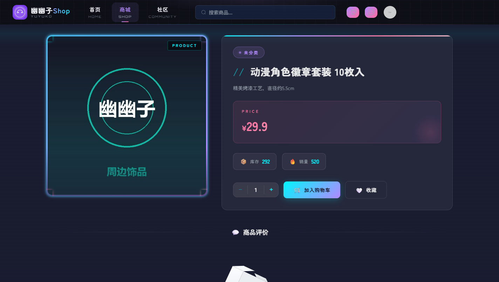
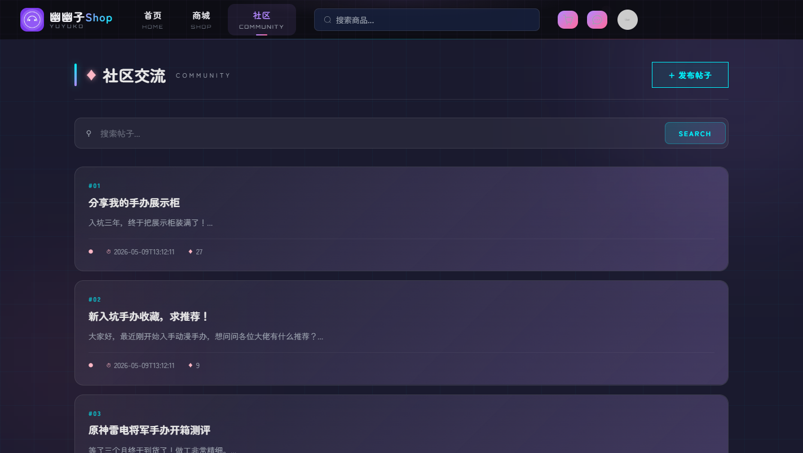
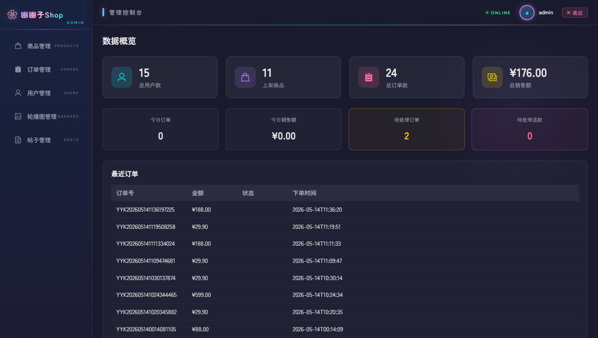

# 幽幽子Shop — 动漫周边商城系统


一个前后端分离的动漫周边 B2C 商城：用户端有商品浏览、购物车、下单支付、社区论坛、私信、勋章墙；管理端有数据看板，以及商品、订单、用户、帖子、轮播图管理。

**后端** Spring Boot 2.7.3 · Spring Security + JWT · MyBatis-Plus 3.5.3.1 · MySQL 8 · 支付宝沙箱 SDK
**前端** Vue 3 + Vite 5 · Element Plus · Vue Router · Pinia · Axios

> 这是我的毕业设计。仓库里**不含任何真实凭据**——数据库密码、JWT 密钥、支付宝密钥全部走环境变量，见下文「配置」。

## 截图

首页轮播、商品列表、商品详情、社区、管理后台：







## 设计文档

- [E-R 图](docs/design/er-diagram.png) · [功能结构图](docs/design/function-map.png)
- [UML 活动图：用户登录](docs/design/uml-activity-login.png) · [商品购买](docs/design/uml-activity-purchase.png)

## 规模

| | |
|---|---|
| Java 源码 | 106 个文件 / 5,652 行 |
| Vue 源码 | 36 个文件 / 16,498 行 |
| 控制器 | 18 个，共 78 个接口 |
| 数据表 | 16 张 |

功能按角色分：用户端 12 个模块（登录注册、商品浏览与筛选、购物车、订单与支付、收货地址、收藏、关注、社区发帖与评论、私信、勋章墙、个人中心），管理端 6 个模块（数据看板、商品、订单、用户、内容、勋章）。

## 配置

所有敏感项都是环境变量，仓库里的 `application.properties` 只有占位符：

```bash
export DB_USERNAME=root
export DB_PASSWORD=你的MySQL密码
export JWT_SECRET=$(openssl rand -base64 48)

# 支付宝沙箱（不配也能跑，只是没有支付功能）
export ALIPAY_APP_ID=你的沙箱应用ID
export ALIPAY_PRIVATE_KEY=你的应用私钥
export ALIPAY_PUBLIC_KEY=支付宝公钥
export ALIPAY_NOTIFY_URL=https://你的外网地址/api/payment/notify
```

沙箱密钥在 https://open.alipay.com/develop/sandbox/app 获取。商户私钥是**单行 PKCS8 格式**，不要带换行。

想用本地文件代替环境变量，就新建 `application-local.properties`（已被 `.gitignore` 排除）并在启动时加 `--spring.profiles.active=local`。

## 跑起来

**1. 建库导数据**

```bash
mysql -uroot -p -e "CREATE DATABASE yuyukoshop CHARACTER SET utf8mb4 COLLATE utf8mb4_unicode_ci;"
cd yuyukoshop/src/main/resources/db
mysql -uroot -p yuyukoshop < schema.sql
mysql -uroot -p yuyukoshop < seed_data.sql
```

`seed_data.sql` 里 12 个商品、16 张表结构、6 个测试用户，密码统一 `123456`。管理员账号 `admin` / `123456`。

**2. 后端**（需要 JDK 11 和 Maven）

```bash
cd yuyukoshop
mvn spring-boot:run
```

跑在 `http://localhost:8080`。**注意：Spring Boot 2.7.3 不支持 JDK 17+**，用 JDK 25 会报 `ExceptionInInitializerError: com.sun.tools.javac.code.TypeTag :: UNKNOWN`，必须切到 JDK 11。

**3. 前端**

```bash
cd yuyukoshop-frontend
npm install
npm run dev
```

跑在 `http://localhost:5176`（5174 被占用时 Vite 自动顺延）。`vite.config.js` 把 `/api` 和 `/uploads` 代理到 8080。

**4. 商品图片**

`seed_data.sql` 里商品图指向 `uploads/product/2026-05-09/*.jpg`，这些文件不在版本控制里。仓库带了一套占位图（`yuyukoshop/uploads/`），所以页面不会开天窗；要换成真图就上传到同一路径。

## 支付流程

下单 → 跳支付宝沙箱收银台 → 同步回调 `/api/payment/return` → 异步通知 `/api/payment/notify`。

异步通知需要外网可达，本地开发得用内网穿透（ngrok / frp 都行）。没有公网地址时，页面上的「扫码支付」能走完，只是异步通知收不到——订单状态停在下单，可以用管理后台手工改。

## 已知边界

- **测试只有 1 个**：`@SpringBootTest` 的 `contextLoads`，而且它需要真 MySQL 才能起来。CI 只编译不跑测试，理由写在 workflow 注释里。
- **没有 Docker**：只有 jar 和静态文件，部署要自己准备 JDK 与 Nginx。
- **前端没有自动化测试**，也没做 SSR。
- **Redis 默认关闭**：`spring.autoconfigure.exclude` 排掉了自动配置。要启用缓存的步骤写在 `application.properties` 注释里。
- **5 个 mapper XML 的路径配了但仓库里是 0 个**：MyBatis-Plus 全部走注解和 BaseMapper，所以不影响运行。

## 目录结构

```
yuyukoshop/                        后端
  src/main/java/com/yuyukoshop/yuyukoshop/
    config/                        安全、CORS、静态资源、Redis
    controller/                    18 个控制器
    service/                       业务逻辑
    entity/  mapper/  dto/  vo/    数据层
  src/main/resources/
    application.properties         全是占位符
    db/                            6 个 SQL 脚本
yuyukoshop-frontend/               前端
  src/views/                       用户端页面
  src/views/admin/                 管理端页面
  src/api/  stores/  router/       请求封装、状态、路由
docs/                              截图与设计图
```

## English

An anime-merchandise e-commerce site, built as a graduation project. Spring Boot 2.7.3 + Spring Security + JWT + MyBatis-Plus + MySQL 8 on the back end, Vue 3 + Element Plus + Vite on the front, with Alipay sandbox payments. 106 Java files / 5,652 lines, 36 Vue files / 16,498 lines, 78 endpoints across 18 controllers.

No credentials are in this repository — database password, JWT secret and Alipay keys all come from environment variables. Setup and run instructions are above; the only thing to know is that Spring Boot 2.7.3 requires JDK 11, not 25.
